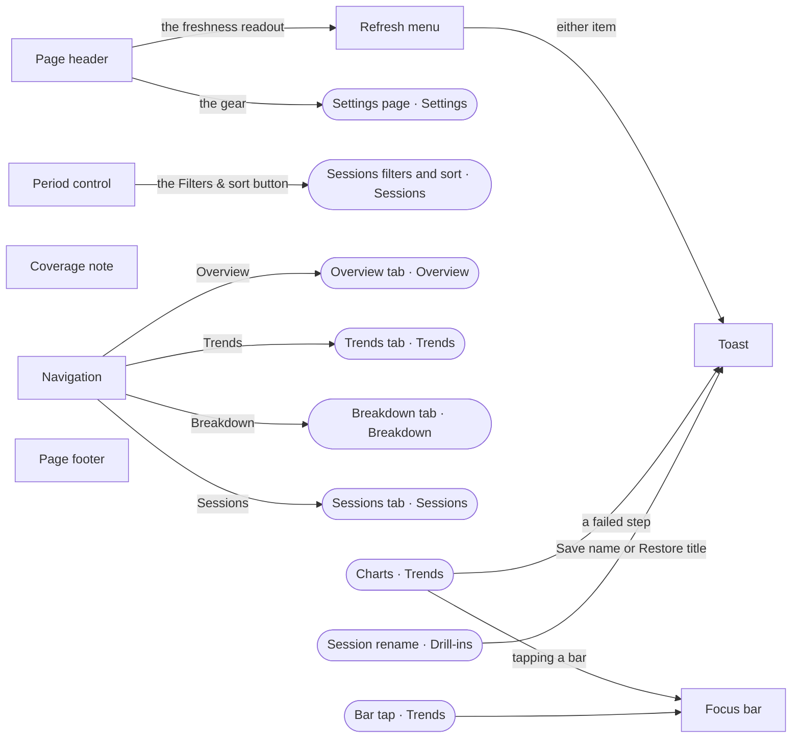
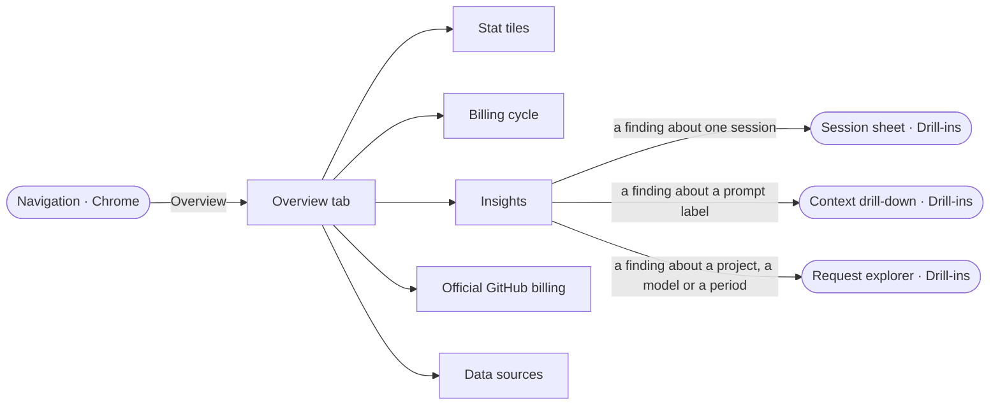
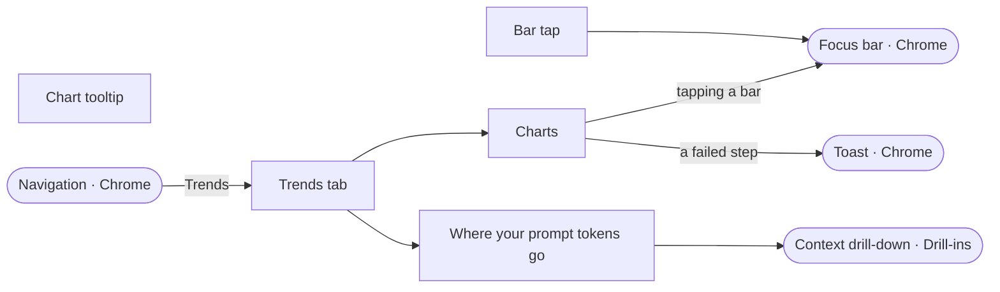
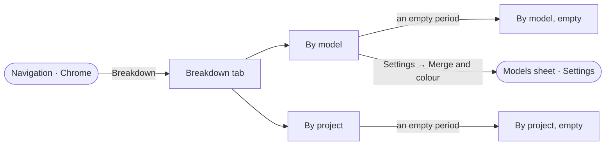
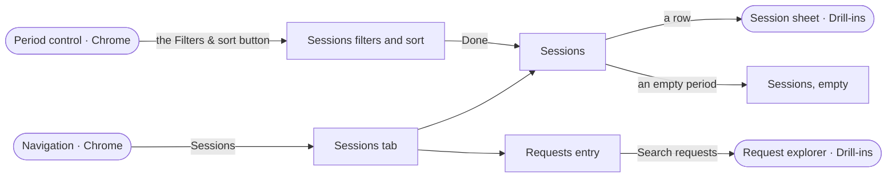
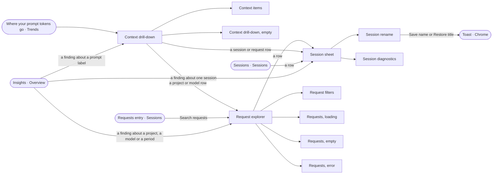
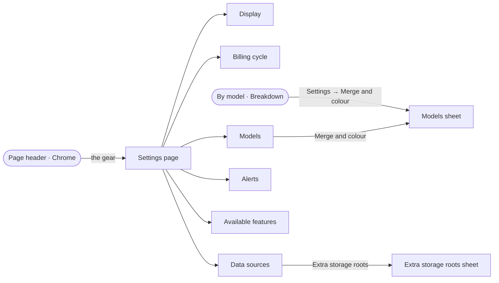

<!-- Generated from docs/ux-surfaces.yaml by scripts/ux_surface_map.py. Do not edit: change the map and re-run. -->

# UX surface map: github-copilot-usage

Every surface a person can reach in this app, each under a stable id that its root element carries as `data-surface`. Each area has a diagram of how its surfaces connect; a rounded node is a surface in another area.

The checklist of everything a person can see and do in the dashboard: every tab, card, sheet, dialog, menu, state, gesture and key, with how it is reached, what is on it and the decision behind it where one exists. [The README](../README.md) tells what each figure means; this page is the exhaustive index, so a layout change can check every surface and not only the ones a reviewer happens to open.

**Keeping it true.** A change that adds, removes, renames or reshapes a user-visible surface updates its entry in `docs/ux-surfaces.yaml` in the same change and regenerates this page with `python scripts/ux_surface_map.py`; this page is never edited by hand. The rule is in `CLAUDE.md`.

**Ids.** `<area>.<surface>`, lowercase words joined by `.` or `-`, the same form the e2e `surface(page, "<id>")` hook takes. An id never changes when a title is reworded, and one id names one surface. The surface's root element carries the same id as `data-surface`; the vendored row menu builds its own element, so the call site in `app.js` stamps the id on what `attach` returns. `scripts/ux_surface_ratchet.py` fails a surface root without an id, an id without an entry, an entry no element carries, an id on two roots, a link to an id with no entry and a page that is not what this map generates. It reads markup and JS, so the entries marked `none` and every screen or state with no root of its own are held by this map and the browser walk alone.

**Four tabs, one gear.** The nav is Overview · Trends · Breakdown · Sessions. Settings is the header gear, one tap from every tab, and is not a tab. The period control and the focus bar sit above the panes and apply to every tab; the header names the tab on show.

**Layout bands.** The same markup serves a phone and a desktop. On a phone the nav is the floating bottom pill, hidden while a dialog is open; on a desktop it is the segmented control at the top. Dialogs are full-height sheets on a phone and centred cards on a desktop (`sheet-wide` ones are wider).

**Where state lives.** The open tab and the folded cards live in the page and `localStorage` (`copilot-usage.tab`, `copilot-usage.collapsed`, `copilot-usage.theme`, `copilot-usage.textsize`, `copilot-usage.fullscreen`); the period or focused date range (`?dash=...`) and the request explorer's filters (`?view=requests&...`) ride the URL, and each committed change is a history entry, so Back and Forward step through them. Every setting that changes the numbers lives in the server's `config.json` and saves as it changes.

**Gating.** A feature block that is switched off (Settings → Available features) hides its part of the page and stops its work: the official billing card with the billing token row, and the pace alert with its Settings group. A block this machine cannot run says why under the Features group.

**Reading the diagrams.** Every list that names a session opens the one session sheet; every list that names a project or a model opens the one request explorer already filtered; the prompt-composition rows and the insights that name a label open the one context drill-down.

## Keyboard and deep links

| Input | Does |
| --- | --- |
| Arrow keys, Home, End on the nav | move between the four tabs |
| Enter or Space on a row or a card heading | opens the row's sheet or folds the card |
| Esc | closes the open dialog or the refresh menu |
| Arrow Down or Up on the freshness readout | opens the refresh menu on its first or last item |
| `/?view=requests&period=…&q=…` | opens the request explorer over that query on load |

Walked 2026-11-17 against build `5a2781c`, at widths 390, 1440, themes light, dark.

## Areas

| Area | Surfaces |
|---|---|
| [Chrome](#chrome) | 8 |
| [Overview](#overview) | 6 |
| [Trends](#trends) | 5 |
| [Breakdown](#breakdown) | 5 |
| [Sessions](#sessions) | 5 |
| [Drill-ins](#drill-ins) | 11 |
| [Settings](#settings) | 9 |

## Chrome

The header, the period control and the strips above the panes, the nav and the toast: present on every tab.

### `chrome.header` Page header

- **Root:** `data-surface`
- **Reach:** every tab, at the top
- **Holds:**
  - the tab's icon and title
  - the context line (the period on show, or the danger line when a refresh failed)
  - the freshness readout with the time of the last refresh (a tab left hidden for over 30 s reloads when it is shown again)
  - the theme toggle
  - the Settings gear
- **Does:**
  - the freshness readout opens the refresh menu
  - the theme toggle flips light and dark and repaints the charts and swatches
  - the gear opens Settings
- **States:** a failed poll keeps the last figures and says "Live data unavailable" in the context line
- **Why:** one vendored header per page, so the gear is one tap from every tab and Settings never needs a tab
- **Leads to:**
  - [Refresh menu](#chromerefresh-menu-refresh-menu) (the freshness readout)
  - [Settings page](#settingssheet-settings-page) (the gear)

### `chrome.refresh-menu` Refresh menu

- **Root:** `data-surface`
- **Reach:**
  - the freshness readout
  - Arrow Down or Up on the readout
- **Holds:**
  - Refresh
  - Force refresh
- **Does:**
  - Refresh re-reads the changed files and toasts the request count
  - Force refresh rebuilds from every file, ignoring the cache
- **States:**
  - a second tap while a refresh runs is ignored; the readout is busy until it returns
  - a refresh already running elsewhere is joined and says so in the toast
- **Why:** a force rebuild is rare and slow, so it sits one tap behind the plain refresh in a menu instead of beside it
- **Leads to:** [Toast](#chrometoast-toast) (either item)

### `chrome.period` Period control

- **Root:** `data-surface`
- **Reach:** below the header, on every tab
- **Holds:**
  - Today, Week, Month, Cycle, All
  - on the Sessions tab only, the Filters & sort button beside it, with a count of the values that differ from the defaults
- **Does:**
  - each button re-reads every figure, table and chart for that period
  - the Filters & sort button opens the Sessions filters sheet
- **States:**
  - a focused date range (from a tapped bar) lights no button
  - the Filters & sort button is hidden on the other three tabs, and its count badge is hidden while the period is Today and the sort is Cost
- **Why:** one period for the whole page, so a figure on one tab never disagrees with another; it stays visible on Overview, Trends and Breakdown, where it is the only control and the dashboard is read by flipping it
- **Leads to:** [Sessions filters and sort](#sessionsfilters-sessions-filters-and-sort) (the Filters & sort button)

### `chrome.focus-bar` Focus bar

- **Root:** `data-surface`
- **Reach:** tapping a bar in a Trends chart
- **Holds:**
  - the words "Focused on" and the dates
  - a Back button naming the period it returns to
- **Does:**
  - Back returns to the period that was open before the focus
  - the focused range is in the address (`?dash=range:...`), so a reload keeps it and the browser's Back and Forward move between focuses
- **States:** hidden unless a bucket is focused
- **Why:** a tapped bucket narrows every figure to its dates, so the bar names the narrowing and undoes it in one tap

### `chrome.coverage-note` Coverage note

- **Root:** `data-surface`
- **Reach:** appears under the period control when a telemetry start date cuts into the period
- **Holds:** one status line
- **States:**
  - partial coverage names the date counting starts from
  - no coverage says the period ends before the start date, and the tiles show a dash
- **Why:** a period the start date does not reach has no figures, which is not the same as zero

### `chrome.nav` Navigation

- **Root:** `data-surface`
- **Reach:** every tab
- **Holds:** Overview, Trends, Breakdown, Sessions
- **Does:** switches the tab, remembers it for the next visit and retitles the header
- **Phone:** the floating bottom pill, hidden while a dialog is open
- **Desktop:** the segmented control above the panes
- **Why:** Settings is the header gear, not a fifth tab
- **Leads to:**
  - [Overview tab](#overviewpane-overview-tab) (Overview)
  - [Trends tab](#trendspane-trends-tab) (Trends)
  - [Breakdown tab](#breakdownpane-breakdown-tab) (Breakdown)
  - [Sessions tab](#sessionspane-sessions-tab) (Sessions)

### `chrome.footer` Page footer

- **Root:** `data-surface`
- **Reach:** the bottom of every tab
- **Holds:** the build line, with the commit and the build time
- **States:** blank until the version loads, and names `unknown` when the server reports no commit

### `chrome.toast` Toast

- **Root:** `data-surface`
- **Reach:** every save, refresh, cache clear and failed write
- **Holds:** one line, in a neutral or error tone
- **Does:** dismisses itself
- **States:** drawn in the top layer, so it shows above an open dialog
- **Why:** each setting saves as it changes, so a toast is the only confirmation

## Overview

The default tab: the four stat tiles, then the cards for the billing cycle, insights, official billing and the data sources.

### `overview.pane` Overview tab

- **Root:** `data-surface`
- **Reach:**
  - the Overview nav tab
  - the first visit
- **Holds:** the tiles, then the cards for the billing cycle, insights, official billing and data sources
- **Does:** each card folds from its heading; the folded set is remembered in the browser
- **Leads to:**
  - [Stat tiles](#overviewtiles-stat-tiles)
  - [Billing cycle](#overviewbudget-billing-cycle)
  - [Insights](#overviewinsights-insights)
  - [Official GitHub billing](#overviewbilling-official-github-billing)
  - [Data sources](#overviewsources-data-sources)

### `overview.tiles` Stat tiles

- **Root:** `data-surface`
- **Reach:** the top of the Overview tab
- **Holds:**
  - Premium requests (credits) with the dollar equivalent and the change against the previous period
  - Requests with credits per request and the estimated count
  - Tokens in with the cache lines
  - Tokens out with failed requests and effective tokens per credit
- **States:**
  - a dash in every tile when the telemetry start date puts the whole period out of reach
  - a token tile reads a dash, not 0, when no request of the period recorded that count; the Tokens in line then names how many requests had no token data
  - the change chip is hidden for All and Cycle
- **Why:** credits lead because the credit is the unit the plan bills in; the dollar figure is derived

### `overview.budget` Billing cycle

- **Root:** `data-surface`
- **Reach:** the Overview tab
- **Holds:**
  - the cycle dates and the day count
  - a meter with a marker at where a linear burn would be today
  - credits used against the allowance
  - the projection for the end of the cycle
- **States:**
  - the meter and a level chip beside the used figure turn to attention at 80% of the allowance used, to a warning when the projection passes the allowance and to critical when the use does
  - hidden when no allowance is set
  - a note says when the telemetry start date cuts the cycle
- **Why:** the marker shows pace, not only use, so a quiet first week is not mistaken for headroom

### `overview.insights` Insights

- **Root:** `data-surface`
- **Reach:** the Overview tab
- **Holds:**
  - rule-based findings, each a row
  - the breakdown coverage line
- **Does:** a row opens the view it refers to
- **States:**
  - a placeholder row when there is no data or no billed credits to attribute
  - the line "Nothing stands out in this period." when every rule is quiet
  - the line "Insights could not be loaded from the dashboard server." when the read failed
- **Why:** findings are computed from fixed rules on this machine with no model call, and an exception is the only row that wears a chip
- **Leads to:**
  - [Session sheet](#drillsession-session-sheet) (a finding about one session)
  - [Context drill-down](#drillcontext-context-drill-down) (a finding about a prompt label)
  - [Request explorer](#drillrequests-request-explorer) (a finding about a project, a model or a period)

### `overview.billing` Official GitHub billing

- **Root:** `data-surface`
- **Reach:** the Overview tab
- **Holds:**
  - an as-of time
  - a table of date, model, credits and dollars over the last 14 days
  - a note with the account-wide total
- **States:**
  - the note carries the server's reason when no token is set or the token is refused
  - the line "No spend recorded in this window." when the account had none
  - a count of days that could not be fetched
  - the line "Could not load billing data from the dashboard server." when the read failed
  - hidden, with its Settings row, when the official billing card block is off
- **Why:** the account-wide official spend is the UTC-exact counterpart of the local figures, so it is a card of its own

### `overview.sources` Data sources

- **Root:** `data-surface`
- **Reach:** the Overview tab
- **Holds:** one row per place Copilot data was found, with the editor, the kind, the session files and request count, the last activity and the path
- **States:**
  - the line "No Copilot data locations found." on a machine with none
  - a row that gives the count of duplicate requests ignored, shown only above zero, when a chat log copied to a second folder was read from the newer file once
- **Why:** the first place to look when a figure is missing or looks doubled is whether its editor was found and read once

## Trends

### `trends.pane` Trends tab

- **Root:** `data-surface`
- **Reach:** the Trends nav tab
- **Holds:** the charts card, then the prompt-composition card
- **Leads to:**
  - [Charts](#trendscharts-charts)
  - [Where your prompt tokens go](#trendsmix-where-your-prompt-tokens-go)

### `trends.charts` Charts

- **Root:** `data-surface`
- **Reach:** the Trends tab
- **Holds:**
  - the window's dates
  - Older, Newer and Latest
  - a hint line
  - the credits-per-model chart
  - the tokens in and out chart
  - the Efficiency chart, effective tokens per credit as bars, with a one-line note
  - the cache read and write chart
- **Does:** Older, Newer and Latest step through earlier windows of the same period
- **States:**
  - the step buttons are dimmed at the ends of the history
  - the step buttons are hidden while a bucket is focused
  - a failed step toasts "Could not load that window. Try again." and keeps the window
- **Why:** the server owns the windows, so a step is one read and the charts never guess how much history exists
- **Leads to:**
  - [Focus bar](#chromefocus-bar-focus-bar) (tapping a bar)
  - [Toast](#chrometoast-toast) (a failed step)

### `trends.bucket-tap` Bar tap

- **Root:** none — a gesture on the charts' canvas, which has no element per bar
- **Reach:** tapping or clicking inside a chart's plot area
- **Does:**
  - picks the nearest bucket and narrows every figure on the page to its dates
  - a tap on the legend or the margins does nothing
- **States:** a bucket the start date puts out of reach is ignored
- **Leads to:** [Focus bar](#chromefocus-bar-focus-bar)

### `trends.tooltip` Chart tooltip

- **Root:** none — drawn on the canvas by the chart library
- **Reach:** hovering a bar, or touching one on a phone
- **Holds:**
  - the credits or tokens of each model in the bucket
  - the bucket's effective input, effective output, credits and tokens per credit, or its cache read and write
  - a coverage footer
- **States:**
  - a series with nothing in the bucket is left out of the tooltip
  - an Efficiency bucket with no bar says why, whether no credits were billed or token counts were not recorded
  - the footer names a bucket the telemetry start date only partly covers

### `trends.mix` Where your prompt tokens go

- **Root:** `data-surface`
- **Reach:** the Trends tab
- **Holds:**
  - one bar per composition label with its share and estimated tokens
  - Who drives this?
- **Does:**
  - a label row opens the context drill-down on that label
  - Who drives this? opens it over the whole prompt
- **States:** hidden when VS Code logged no composition for the period
- **Why:** the composition is VS Code's own per-request breakdown, weighted by prompt size, so a high tool-definition share shows where to trim
- **Leads to:** [Context drill-down](#drillcontext-context-drill-down)

## Breakdown

### `breakdown.pane` Breakdown tab

- **Root:** `data-surface`
- **Reach:** the Breakdown nav tab
- **Holds:**
  - the model and project cards
  - Export CSV
- **Does:** Export CSV downloads the period's requests as a CSV file
- **Leads to:**
  - [By model](#breakdownmodels-by-model)
  - [By project](#breakdownprojects-by-project)

### `breakdown.models` By model

- **Root:** `data-surface`
- **Reach:** the Breakdown tab
- **Holds:** a table of model, requests, credits, share and tokens in and out, one coloured swatch per model
- **Does:** a model's hover names every spelling merged into it
- **States:** the empty state when the period has no usage
- **Why:** spellings of one model that differ only in case, spacing or a release date share a row, so a model is counted once
- **Leads to:**
  - [By model, empty](#breakdownmodels-empty-by-model-empty) (an empty period)
  - [Models sheet](#settingsmodels-sheet-models-sheet) (Settings → Merge and colour)

### `breakdown.models-empty` By model, empty

- **Root:** `data-surface`
- **Reach:** a period with no usage
- **Holds:**
  - No Copilot usage in this period.
  - Show all time
- **Does:** Show all time switches the period to All
- **States:** the button is hidden when the period is already All

### `breakdown.projects` By project

- **Root:** `data-surface`
- **Reach:** the Breakdown tab
- **Holds:**
  - the request count per mode in the heading
  - a table of project, requests, credits and tokens in and out
- **States:** the empty state when the period has no usage
- **Leads to:** [By project, empty](#breakdownprojects-empty-by-project-empty) (an empty period)

### `breakdown.projects-empty` By project, empty

- **Root:** `data-surface`
- **Reach:** a period with no usage
- **Holds:**
  - No Copilot usage in this period.
  - Show all time
- **Does:** Show all time switches the period to All

## Sessions

### `sessions.pane` Sessions tab

- **Root:** `data-surface`
- **Reach:** the Sessions nav tab
- **Holds:** the sessions card, then the requests card
- **Leads to:**
  - [Sessions](#sessionslist-sessions)
  - [Requests entry](#sessionsrequests-entry-requests-entry)

### `sessions.list` Sessions

- **Root:** `data-surface`
- **Reach:** the Sessions tab
- **Holds:**
  - a count in the heading
  - one row per session with its project, time span, request count, editor, credits and flag chips
  - Show all, or Show fewer
- **Does:**
  - a row opens the session sheet
  - Show all expands the preview to every session
- **States:**
  - a preview of the first few sessions until expanded
  - the empty state when the period has none
- **Why:** sessions are sorted by cost first because the question the tab answers is what burned the credits
- **Leads to:**
  - [Session sheet](#drillsession-session-sheet) (a row)
  - [Sessions, empty](#sessionsempty-sessions-empty) (an empty period)

### `sessions.filters` Sessions filters and sort

- **Root:** `data-surface`
- **Reach:** the Filters & sort button beside the period control, on the Sessions tab
- **Holds:**
  - Sort: Cost and Recent
  - Period: Today, Week, Month, Cycle, All (the same choice as the control on the page)
  - Clear and Done
- **Does:**
  - each choice applies at once and the list, the totals and the badge on the button follow
  - Clear returns the sort to Cost and the period to Today
  - Done and the close button end the sheet
- **States:** the title and the footer stay pinned and the body scrolls, so Done stays on screen at 390 by 664
- **Why:** the tab has two controls (the period and the sort), and the fleet rule puts two or more into one sheet with a count on its trigger, so a re-sorted or narrowed list never looks like the whole one
- **Leads to:** [Sessions](#sessionslist-sessions) (Done)

### `sessions.empty` Sessions, empty

- **Root:** `data-surface`
- **Reach:** a period with no sessions
- **Holds:**
  - No sessions in this period.
  - Show all time
- **Does:** Show all time switches the period to All

### `sessions.requests-entry` Requests entry

- **Root:** `data-surface`
- **Reach:** the Sessions tab
- **Holds:**
  - a one-line description
  - Search requests
- **Does:** Search requests opens the request explorer on the page's period
- **Leads to:** [Request explorer](#drillrequests-request-explorer) (Search requests)

## Drill-ins

Three dialogs hold every drill-in: the session sheet, the context drill-down and the request explorer. Each is reached from several lists; none is reached by a URL except the request explorer, and Back closes it.

### `drill.session` Session sheet

- **Root:** `data-surface`
- **Reach:**
  - a row in Sessions, in the request explorer or in the context drill-down
  - an insight about one session
- **Holds:**
  - the session's title and a close button
  - the meta line, with the project, editor, time span, requests, credits and their dollar equivalent, cache lines and the estimated count
  - the rename row
  - the diagnostics block
  - the prompt composition of the session
  - a list of requests, each a row with the prompt, time, model, tokens in and out and credits
  - under a request that is opened: the requested and used model, mode, input volume, context processed, uncached input, cache read, cache write, output, credits and time taken, the stored prompt in full, and the names of its attached files, tools and attachments when it logged any
  - Save name
- **Does:**
  - the close button and Esc close it
  - a request row opens and closes its detail in place
- **States:**
  - an estimated request is marked ~ and explained in the meta line
  - an opened estimated request marks its figures ~ and names the source of the estimate
  - a request the Copilot CLI recorded no token counts for shows a dash for each figure, says why under its detail, and the meta line counts such requests
  - a VS Code prompt of 200 characters or more says the log keeps only the first 200
  - an errored request is dimmed and carries a warning glyph
- **Phone:** a full-height sheet
- **Desktop:** a wide centred card
- **Why:** one sheet for every list that names a session, so a session reads the same wherever it is reached
- **Leads to:**
  - [Session rename](#drillsession-rename-session-rename)
  - [Session diagnostics](#drillsession-diagnostics-session-diagnostics)

### `drill.session-rename` Session rename

- **Root:** `data-surface`
- **Reach:** the Name row of the session sheet
- **Holds:**
  - a name field placeholdered with the parsed title
  - Restore title, once a custom name is set
- **Does:**
  - Save name stays asleep until the name differs from the saved one
  - Save name stores the name in this dashboard's config, never in Copilot's files
  - Restore title clears the custom name
- **States:** a failed save toasts "Could not save the name. Try again."
- **Why:** the name lives in config.json so a rename never touches a file the editor owns
- **Leads to:** [Toast](#chrometoast-toast) (Save name or Restore title)

### `drill.session-diagnostics` Session diagnostics

- **Root:** `data-surface`
- **Reach:** the session sheet, when the session has a logged prompt size
- **Holds:**
  - the largest prompt, the growth from first to last prompt and the share outside the user's own context
  - one line per flag with its heuristic wording
  - a closed disclosure listing the prompt size of each sized request in order with the percentage change from the previous one
- **Does:** the disclosure opens and closes the growth list
- **States:**
  - hidden when the session logged no prompt size
  - no growth list with fewer than two sized requests
- **Why:** the flags are heuristics, worded as such, and never a verdict

### `drill.context` Context drill-down

- **Root:** `data-surface`
- **Reach:**
  - Who drives this?
  - a label row in Where your prompt tokens go
  - an insight about a prompt label
- **Holds:**
  - the label as the title, and the period
  - chips for All of the prompt and each label with its share
  - the coverage line
  - the files, tools and attachments that rode along most often
  - Projects, Models, Sessions and Requests, each a list of rows with a share
  - a note
- **Does:**
  - a chip reloads the lists for that label
  - a project or model row opens the request explorer filtered to it
  - a session or request row opens the session sheet
- **States:**
  - the title shows "loading…" while the read runs
  - the empty state carries the server's reason
- **Why:** the shares are estimates weighted by prompt size, so the coverage line says how much of the period has a breakdown
- **Leads to:**
  - [Context items](#drillcontext-items-context-items)
  - [Context drill-down, empty](#drillcontext-empty-context-drill-down-empty)
  - [Session sheet](#drillsession-session-sheet) (a session or request row)
  - [Request explorer](#drillrequests-request-explorer) (a project or model row)

### `drill.context-items` Context items

- **Root:** `data-surface`
- **Reach:** the context drill-down, above Projects
- **Holds:** up to twenty names of attached files, tools and attachments, each with the number of the period's requests that carried it and a proportion bar
- **States:**
  - a period with none logged says so in one line
  - the names alone are kept, never the content, and the list ignores the selected label
- **Why:** the composition says which category of the prompt is large; the names say which tools and files ride along on every request

### `drill.context-empty` Context drill-down, empty

- **Root:** `data-surface`
- **Reach:** the context drill-down, when no breakdown is recorded for the label or the read failed
- **Holds:** the reason, or "Could not load the drill-down from the dashboard server."

### `drill.requests` Request explorer

- **Root:** `data-surface`
- **Reach:**
  - Search requests
  - a project, a model or a period row from an insight or the context drill-down
  - a link with `?view=requests` on load
- **Holds:**
  - the title and a close button
  - its own period control
  - a search field
  - a sort select and an order toggle
  - the Filters disclosure
  - a summary line
  - the request rows
  - Previous, Next and the page number
- **Does:**
  - every committed change (a filter, the sort, the order, the page, the period) reloads the rows and adds a history entry, so a reload or a shared link lands on the same view and Back and Forward step through the views; typing in a text box rewrites the current entry instead
  - a row opens the session sheet
  - Back from the opened sheet closes it and stays in the app; closing with the button adds the plain dashboard address
- **States:**
  - the Filters disclosure is folded on a phone unless a filter is set, and open on a desktop
  - the pager is hidden when there is one page
  - a request with no billing data reads "unbilled"
- **Phone:** a full-height sheet
- **Desktop:** a wide centred card
- **Why:** the URL carries every filter so the view is linkable, and a history entry per change lets Back return to the previous filter set
- **Leads to:**
  - [Request filters](#drillrequests-filters-request-filters)
  - [Requests, loading](#drillrequests-loading-requests-loading)
  - [Requests, empty](#drillrequests-empty-requests-empty)
  - [Requests, error](#drillrequests-error-requests-error)
  - [Session sheet](#drillsession-session-sheet) (a row)

### `drill.requests-filters` Request filters

- **Root:** `data-surface`
- **Reach:** the Filters disclosure of the request explorer
- **Holds:**
  - a count badge of active filters
  - Project, Model, Mode, Editor and Result selects
  - Min credits and Max credits
  - Clear filters
- **Does:**
  - each choice narrows the rows; a facet lists only values that exist
  - Clear filters resets every filter but the period and the search
- **States:** the badge and Clear filters are hidden while no filter is set

### `drill.requests-loading` Requests, loading

- **Root:** `data-surface`
- **Reach:** the first load of the request explorer
- **Holds:** Reading requests…
- **States:** later pages keep the rows on screen instead of returning to this block

### `drill.requests-empty` Requests, empty

- **Root:** `data-surface`
- **Reach:** a query that matches nothing
- **Holds:** No requests match these filters.

### `drill.requests-error` Requests, error

- **Root:** `data-surface`
- **Reach:** a failed read
- **Holds:**
  - Could not load requests.
  - Retry
- **Does:** Retry reads the same query again

## Settings

| Group | Row | Value shown | Holds |
| --- | --- | --- | --- |
| Display | **Text size** | Small / Default / Large | a three-way control, applied at once |
| Billing cycle | **Allowance** | credits | a number; saves on leaving the field |
| | **Reset day** | day of month | 1 to 28; saves on leaving the field |
| Models | **Merge and colour** | *Default* or a count | opens the Models sheet |
| Data sources | **Start date** | a date | counts nothing older; **Count every record** appears while one is set |
| | **Extra storage roots** | *None* or a count | opens the roots sheet |
| | **Billing token** | Configured / Not set | read-only status (billing card on) |
| | **Clear cache** | none | rebuilds from the files |
| Alerts | **Pace alert (Telegram)** | On / Off | status, with **Send test message** when on (pace alert on) |
| Available features | one switch per block | ON / OFF, or *Unavailable on this machine* | Copilot CLI sessions, Official billing card, Pace alert, Usage log, Tailscale access |

### `settings.sheet` Settings page

- **Root:** `data-surface`
- **Reach:** the header gear
- **Holds:**
  - Display, Billing cycle, Models, Data sources, Alerts and Available features
  - a close button
- **Does:** every setting saves as it changes and a toast confirms; there is no Save button
- **States:** opens on stale values when the config read fails
- **Phone:** a full-screen page
- **Desktop:** a centred column at the layout measure
- **Why:** a setting that changes the numbers saves at once, so the figures behind the sheet are already right when it closes
- **Leads to:**
  - [Display](#settingsdisplay-display)
  - [Billing cycle](#settingscycle-billing-cycle)
  - [Models](#settingsmodels-models)
  - [Data sources](#settingssources-data-sources)
  - [Alerts](#settingsalerts-alerts)
  - [Available features](#settingsfeatures-available-features)

### `settings.display` Display

- **Root:** `data-surface`
- **Reach:** Settings
- **Holds:**
  - Text size, with Small, Default and Large
  - Full screen on Edge, a switch shown only in Edge
- **Does:**
  - applies at once and is remembered in the browser
  - the full-screen switch enters full screen at once, and the first tap after a reload enters again while it is on
- **Why:** the zoom-lock escape, since the page forbids pinch zoom on a phone

### `settings.cycle` Billing cycle

- **Root:** `data-surface`
- **Reach:** Settings
- **Holds:**
  - Allowance in credits
  - Reset day of the month
  - a footnote with the plan defaults
- **Does:**
  - a value saves when the field loses focus
  - a value out of range snaps to the nearest valid one
  - an empty or non-numeric value is put back
- **States:** a failed save puts the field back and toasts an error

### `settings.models` Models

- **Root:** `data-surface`
- **Reach:** Settings
- **Holds:** Merge and colour, with *Default* or a count of merged models and colours
- **Does:** opens the Models sheet
- **Leads to:** [Models sheet](#settingsmodels-sheet-models-sheet) (Merge and colour)

### `settings.sources` Data sources

- **Root:** `data-surface`
- **Reach:** Settings
- **Holds:**
  - Start date
  - Count every record
  - Extra storage roots with its count
  - Billing token with its status
  - Clear cache
  - Health check with its last result, and a sentence under the group with the slowest check
- **Does:**
  - Start date leaves every earlier record out of every total
  - Count every record clears the start date
  - Extra storage roots opens the roots sheet
  - Clear cache rebuilds from the files and toasts
  - Health check times the real API over a temporary copy of the read model and reports against a budget, never changing the live data
- **States:**
  - Count every record exists only while a start date is set
  - Billing token and its note exist only while the billing card is on; the note names the environment variable to set
  - an unreadable date is refused and the field returns to its last value
  - Health check reads Not run, Running (the row is disabled while it polls), Passed, Over budget, Failed, Incomplete or Unavailable with the reason; a second tap while one runs toasts that one is running
- **Leads to:** [Extra storage roots sheet](#settingsroots-extra-storage-roots-sheet) (Extra storage roots)

### `settings.alerts` Alerts

- **Root:** `data-surface`
- **Reach:** Settings, while the pace alert block is on
- **Holds:**
  - Pace alert (Telegram) with its status
  - Send test message
  - a footnote with the reason it is off, when it is
- **Does:** Send test message posts to Telegram and toasts the result
- **States:**
  - the group is hidden when the pace alert block is off
  - Send test message is hidden while the alert is off
  - the status reads Off with the reason when no bot token or chat is set
- **Why:** one message per cycle, sent after Telegram accepted it, so a failed send is retried

### `settings.features` Available features

- **Root:** `data-surface`
- **Reach:** Settings
- **Holds:**
  - a switch each for Copilot CLI sessions, Official billing card, Pace alert and Usage log
  - Tailscale access
  - footnotes
- **Does:**
  - a switch applies at once, hides or shows its part of the page and stops or starts its work
  - Tailscale access applies when the server restarts
- **States:**
  - a block this machine cannot run reads "Unavailable on this machine" with the reason under the group
  - the Tailscale hint reads Off, On, On after restart, Off after restart or Unavailable here
- **Why:** each switch is for this machine only, so a block that cannot run never looks broken

### `settings.roots` Extra storage roots sheet

- **Root:** `data-surface`
- **Reach:** Settings → Extra storage roots
- **Holds:**
  - one path per line in a text area
  - a footnote
- **Does:** saves when the field loses focus and again when the sheet closes
- **States:** a failed save puts the previous paths back
- **Why:** paths are free text and cannot be a one-line row

### `settings.models-sheet` Models sheet

- **Root:** `data-surface`
- **Reach:** Settings → Merge and colour
- **Holds:**
  - one card per model in the local history, with its swatch, name and request count
  - Merge into
  - Colour family and Opacity
  - the spellings it holds and what it absorbed
- **Does:**
  - each choice saves as it changes and toasts
  - Merge into counts a model under another's name
  - Colour family and Opacity recolour a model; clearing a choice restores the default
- **States:**
  - a model that is merged into another has no colour choices
  - a model another is merged into cannot itself be merged
  - No models in the local history yet.
- **Why:** colours follow the provider by default, one shade per model within it

## Link index

| From | Via | To |
|---|---|---|
| [Page header](#chromeheader-page-header) | the freshness readout | [Refresh menu](#chromerefresh-menu-refresh-menu) |
| [Page header](#chromeheader-page-header) | the gear | [Settings page](#settingssheet-settings-page) |
| [Refresh menu](#chromerefresh-menu-refresh-menu) | either item | [Toast](#chrometoast-toast) |
| [Period control](#chromeperiod-period-control) | the Filters & sort button | [Sessions filters and sort](#sessionsfilters-sessions-filters-and-sort) |
| [Navigation](#chromenav-navigation) | Overview | [Overview tab](#overviewpane-overview-tab) |
| [Navigation](#chromenav-navigation) | Trends | [Trends tab](#trendspane-trends-tab) |
| [Navigation](#chromenav-navigation) | Breakdown | [Breakdown tab](#breakdownpane-breakdown-tab) |
| [Navigation](#chromenav-navigation) | Sessions | [Sessions tab](#sessionspane-sessions-tab) |
| [Overview tab](#overviewpane-overview-tab) |  | [Stat tiles](#overviewtiles-stat-tiles) |
| [Overview tab](#overviewpane-overview-tab) |  | [Billing cycle](#overviewbudget-billing-cycle) |
| [Overview tab](#overviewpane-overview-tab) |  | [Insights](#overviewinsights-insights) |
| [Overview tab](#overviewpane-overview-tab) |  | [Official GitHub billing](#overviewbilling-official-github-billing) |
| [Overview tab](#overviewpane-overview-tab) |  | [Data sources](#overviewsources-data-sources) |
| [Insights](#overviewinsights-insights) | a finding about one session | [Session sheet](#drillsession-session-sheet) |
| [Insights](#overviewinsights-insights) | a finding about a prompt label | [Context drill-down](#drillcontext-context-drill-down) |
| [Insights](#overviewinsights-insights) | a finding about a project, a model or a period | [Request explorer](#drillrequests-request-explorer) |
| [Trends tab](#trendspane-trends-tab) |  | [Charts](#trendscharts-charts) |
| [Trends tab](#trendspane-trends-tab) |  | [Where your prompt tokens go](#trendsmix-where-your-prompt-tokens-go) |
| [Charts](#trendscharts-charts) | tapping a bar | [Focus bar](#chromefocus-bar-focus-bar) |
| [Charts](#trendscharts-charts) | a failed step | [Toast](#chrometoast-toast) |
| [Bar tap](#trendsbucket-tap-bar-tap) |  | [Focus bar](#chromefocus-bar-focus-bar) |
| [Where your prompt tokens go](#trendsmix-where-your-prompt-tokens-go) |  | [Context drill-down](#drillcontext-context-drill-down) |
| [Breakdown tab](#breakdownpane-breakdown-tab) |  | [By model](#breakdownmodels-by-model) |
| [Breakdown tab](#breakdownpane-breakdown-tab) |  | [By project](#breakdownprojects-by-project) |
| [By model](#breakdownmodels-by-model) | an empty period | [By model, empty](#breakdownmodels-empty-by-model-empty) |
| [By model](#breakdownmodels-by-model) | Settings → Merge and colour | [Models sheet](#settingsmodels-sheet-models-sheet) |
| [By project](#breakdownprojects-by-project) | an empty period | [By project, empty](#breakdownprojects-empty-by-project-empty) |
| [Sessions tab](#sessionspane-sessions-tab) |  | [Sessions](#sessionslist-sessions) |
| [Sessions tab](#sessionspane-sessions-tab) |  | [Requests entry](#sessionsrequests-entry-requests-entry) |
| [Sessions](#sessionslist-sessions) | a row | [Session sheet](#drillsession-session-sheet) |
| [Sessions](#sessionslist-sessions) | an empty period | [Sessions, empty](#sessionsempty-sessions-empty) |
| [Sessions filters and sort](#sessionsfilters-sessions-filters-and-sort) | Done | [Sessions](#sessionslist-sessions) |
| [Requests entry](#sessionsrequests-entry-requests-entry) | Search requests | [Request explorer](#drillrequests-request-explorer) |
| [Session sheet](#drillsession-session-sheet) |  | [Session rename](#drillsession-rename-session-rename) |
| [Session sheet](#drillsession-session-sheet) |  | [Session diagnostics](#drillsession-diagnostics-session-diagnostics) |
| [Session rename](#drillsession-rename-session-rename) | Save name or Restore title | [Toast](#chrometoast-toast) |
| [Context drill-down](#drillcontext-context-drill-down) |  | [Context items](#drillcontext-items-context-items) |
| [Context drill-down](#drillcontext-context-drill-down) |  | [Context drill-down, empty](#drillcontext-empty-context-drill-down-empty) |
| [Context drill-down](#drillcontext-context-drill-down) | a session or request row | [Session sheet](#drillsession-session-sheet) |
| [Context drill-down](#drillcontext-context-drill-down) | a project or model row | [Request explorer](#drillrequests-request-explorer) |
| [Request explorer](#drillrequests-request-explorer) |  | [Request filters](#drillrequests-filters-request-filters) |
| [Request explorer](#drillrequests-request-explorer) |  | [Requests, loading](#drillrequests-loading-requests-loading) |
| [Request explorer](#drillrequests-request-explorer) |  | [Requests, empty](#drillrequests-empty-requests-empty) |
| [Request explorer](#drillrequests-request-explorer) |  | [Requests, error](#drillrequests-error-requests-error) |
| [Request explorer](#drillrequests-request-explorer) | a row | [Session sheet](#drillsession-session-sheet) |
| [Settings page](#settingssheet-settings-page) |  | [Display](#settingsdisplay-display) |
| [Settings page](#settingssheet-settings-page) |  | [Billing cycle](#settingscycle-billing-cycle) |
| [Settings page](#settingssheet-settings-page) |  | [Models](#settingsmodels-models) |
| [Settings page](#settingssheet-settings-page) |  | [Data sources](#settingssources-data-sources) |
| [Settings page](#settingssheet-settings-page) |  | [Alerts](#settingsalerts-alerts) |
| [Settings page](#settingssheet-settings-page) |  | [Available features](#settingsfeatures-available-features) |
| [Models](#settingsmodels-models) | Merge and colour | [Models sheet](#settingsmodels-sheet-models-sheet) |
| [Data sources](#settingssources-data-sources) | Extra storage roots | [Extra storage roots sheet](#settingsroots-extra-storage-roots-sheet) |
